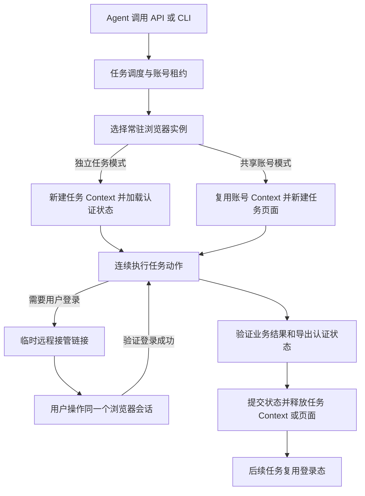

# 服务端轻量 Agent 浏览器可行性与同类方案

实现进展：按后续确认的“一个浏览器二进制＋一个 Skill 文档”交付范围，已实现 Agent Web。实际采用 Go＋Rod/CDP 和内置 Headless Chromium，避免独立发行包依赖 Node.js；第一版按账号保留持久 Profile，同账号任务复用浏览器并串行执行。安装和运行方式见 [README](README.md)。下文保留架构评估及后续扩展选项。

调研日期为 2026 年 11 月 10 日。需求以更快、更低资源占用为优先，允许多个任务复用同一个浏览器实例。任务内连续执行导航、读取、点击和填表，结束后释放任务占用的页面或 Context。部署环境按 Linux 服务器评估，登录态按同一用户、同一网站账号跨任务复用设计。

**开发决策：当前需求不需要另行开发浏览器内核或维护 Chromium 分支。优先直接使用现有浏览器，按部署要求选择接入现成浏览器服务，或用 Playwright 封装自己的任务服务。** 下文的池化、认证状态和调度设计属于浏览器外层的服务开发；是否全部自建，取决于现有服务对部署、费用和性能的匹配程度。具体选型边界见第 8 节。

**总体可行。首选架构调整为常驻 Headless Chromium 浏览器池，每任务创建轻量 BrowserContext，并配套认证状态库和临时人工接管页面。** 多个任务共享浏览器启动成本，Context 提供 Cookie 和站点存储隔离。同账号需要持续共享登录态时，可以复用一个账号 Context，为每个任务分配独立标签页。Playwright 已提供这些基础能力，开发重点转向任务调度、状态管理和资源回收。具体性能收益仍需在目标网站上测量。 [Playwright Context 隔离](https://playwright.dev/docs/browser-contexts) · [创建 Context](https://playwright.dev/docs/api/class-browser#browser-new-context) · [Kernel 同账号任务拓扑](https://www.kernel.sh/docs/browsers/profiles#use-profiles-concurrently)

## 1. 三项需求的可行性

| 需求 | 评估 | 需要明确的实现条件 |
| --- | --- | --- |
| 面向 Agent，在服务器自动浏览和操作网页 | 高度可行 | 通过 API、CLI 或 MCP 接入。浏览器运行在服务器，客户端传指令和接收结构化结果。 |
| 完全没有 UI | 自动执行阶段可行 | 用户登录时仍需要一个交互入口。可按需提供临时远程网页画面，也可对支持扫码或设备授权的网站返回相应信息。 |
| 轻量、快速 | 可以优化，收益依负载与网站而定 | 复用实例可减少重复启动和浏览器基础开销；页面 JavaScript、布局、网络和模型推理仍消耗资源。先测会话复用收益，再评估精简渲染能力的引擎。 |
| 多任务复用浏览器 | 高度可行，作为默认方案 | 一个常驻浏览器实例承载多个 Context 或页面。任务结束关闭所属 Context 或页面，浏览器按空闲、内存和健康状况回收。 |
| Cookie 等状态跨任务共享 | 可行，支持两种模式 | 独立 Context 通过快照复用登录态；同账号共享 Context 时直接共享 Cookie 和同源存储。账号切换、登录和退出等动作仍需协调。 |

这里的“无 UI”按服务端无需桌面操作界面理解。Chrome Headless 保留网页渲染能力，可以生成真实截图。Lightpanda 省去了图形渲染管线，页面结构和 JavaScript 仍能运行，但可视化交接需要另一个能够真实渲染网页的浏览器。 [Chrome Headless 实现](https://developer.chrome.com/docs/automation-and-testing/headless) · [Lightpanda 架构](https://lightpanda.io/docs/core-concepts/architecture-overview) · [Chromium 多进程架构](https://www.chromium.org/developers/design-documents/multi-process-architecture/)

## 2. 推荐的任务运行方式

浏览器实例、BrowserContext 和 Page 是三个不同的管理层。一个 Chromium 实例可以承载多个 Context，一个 Context 可以承载多个 Page。Context 隔离 Cookie 和站点存储，同一个 Context 内的页面共享符合域和存储分区规则的状态。Chromium 仍会使用渲染器等子进程，因此资源统计应覆盖整个实例的进程树。 [Playwright Browser API](https://playwright.dev/docs/api/class-browser#browser-new-context) · [Chromium 架构](https://www.chromium.org/developers/design-documents/multi-process-architecture/)

| 运行方式 | 启动与状态开销 | 任务隔离与故障范围 | 建议用途 |
| --- | --- | --- | --- |
| 每任务独立浏览器实例 | 每任务启动浏览器、恢复状态 | 可按实例施加资源限制和回收 | 特殊兼容需求或需要独立故障边界的任务 |
| 常驻浏览器，每任务独立 Context | 创建 Context、恢复认证状态，摊薄浏览器启动成本 | 任务存储独立；浏览器主进程故障可能影响多个任务 | 第一版默认方案 |
| 常驻浏览器，每账号一个 Context，每任务独立 Page | 热账号通常只需创建页面，减少认证状态恢复 | 同账号页面共享站点存储和认证变化，任务影响范围更大 | 需要连续共享登录态且已验证兼容的账号 |

以上是架构取舍。Context 创建成本较低已有官方文档支持，三种模式在你的任务集上的延迟和内存差异仍待测量。 [Playwright 隔离说明](https://playwright.dev/docs/browser-contexts)

推荐保留一个轻量的常驻控制服务，负责排队、账号租约、浏览器池和结果存储。实例启动一次后服务多个任务，任务内多轮 Agent 调用都绑定同一 Context 和页面。低并发原型可以从一个浏览器实例开始，负载增加后扩为有容量上限的小型池。空闲池可以缩容，持续流量下保留预热实例。

接口可设计为 `createTask(accountId)`、`act(taskId, actions)`、`observe(taskId)`、`requestHuman(taskId)` 和 `finish(taskId)`。它们是建议接口，前端协议可选 HTTP 或 MCP。CLI 每次运行后退出，并通过 `taskId` 连接服务器中仍在运行的任务。Steel 已使用相似的客户端与会话分离方式。 [Steel CLI 会话协议](https://github.com/steel-dev/cli/blob/main/docs/references/steel-browser.md)

任务超时或失联时，控制服务关闭该任务的 Context，或在账号共享模式下关闭该任务创建的全部页面和弹窗。调度映射必须绑定 `taskId → browserId → contextId → pageIds`，Agent 接口只允许操作映射中的对象。共享浏览器的原始 CDP 端点由服务内部持有，避免其他任务枚举或操作无关页面。

限制每个实例的 Context 数、页面数和任务时长，并跟踪内存高水位。浏览器需要回收时，先停止分配新任务，等待已有任务完成或到期，再保存可恢复状态、关闭和重启实例。浏览器主进程崩溃时，其上的任务进入中断恢复流程。Context 是站点状态隔离单元，强租户隔离或严格单任务资源配额可以另用独立实例或容器。

## 3. 跨任务共享登录态的实现

**复用浏览器后，登录态可以按需选择快照共享或同账号共享 Context。** 独立 Context 模式中，新任务恢复最近提交的认证状态，正在运行的任务继续持有自己的副本。同账号共享 Context 模式中，页面访问同一个 Cookie 容器和同源 LocalStorage、IndexedDB，后续请求可以使用更新后的 Cookie。页面内已缓存的令牌、DOM 和标签级 SessionStorage 仍各自保留，必要时需刷新或由应用同步。 [Playwright Context](https://playwright.dev/docs/api/class-browser#browser-new-context) · [Kernel 同账号共享方式](https://www.kernel.sh/docs/browsers/profiles#use-profiles-concurrently) · [SessionStorage 语义](https://developer.mozilla.org/en-US/docs/Web/API/Window/sessionStorage)

### Context 与认证状态库

池内每个 Chromium 实例拥有自己的数据目录，任务通过 `browser.newContext({ storageState })` 创建非持久 Context。Context 之间隔离 Cookie 和缓存，存储恢复依赖显式导入导出。原来的目录互斥约束仍适用于多个浏览器实例共享同一个 `user-data-dir`，一个实例内创建多个 Context 则是受支持的标准用法。 [创建 Context](https://playwright.dev/docs/api/class-browser#browser-new-context) · [持久目录约束](https://playwright.dev/docs/api/class-browsertype#browser-type-launch-persistent-context)

账号 Context 即使跨任务保持存活，也要在登录完成、认证更新后的合适边界和关闭前保存状态，以便浏览器重启后恢复。导出前暂停该账号的状态修改动作，并等待相关请求稳定。长期空闲的账号 Context 保存后释放，通过空闲超时控制常驻内存。

| 数据 | 建议处理方式 | 对任务恢复的影响 |
| --- | --- | --- |
| Cookies | 保留名称、域、路径、过期时间、Secure、HttpOnly、SameSite，以及实现支持的分区属性，通过浏览器接口导入导出 | HttpOnly Cookie 可由受授权的浏览器控制接口处理。仅使用页面 `document.cookie` 会漏掉这些 Cookie。 |
| LocalStorage | 按完整 origin 保存和恢复 | 某些网站的访问令牌存放在这里。 |
| IndexedDB | 对依赖它的网站启用导出和恢复，并验证数据类型兼容性 | Playwright 提供可选的 IndexedDB 状态捕获。 |
| SessionStorage | 对目标网站按需适配，在相应标签和 origin 的初始化阶段恢复 | 它按页面会话组织，通常需要额外代码处理。 |
| 内存变量、DOM、当前弹窗、进行中的请求 | 在任务所属页面和 Context 中保留 | 页面或 Context 关闭后，后续任务从明确的入口重新建立流程。 |
| 完整 Profile | 对需要完整 Profile 的账号使用专用持久实例，关闭浏览器后生成一致快照 | 普通非持久 Context 的状态导出只覆盖所支持的数据类型；完整 Profile 保存内容更多。 |

状态导出支持的范围随工具版本变化，应固定版本。Playwright 的认证文档和 `storageState` API 可作为实现基础，SessionStorage 的网页语义以 MDN 为准。 [认证复用](https://playwright.dev/docs/auth) · [BrowserContext 存储 API](https://playwright.dev/docs/api/class-browsercontext#browser-context-storage-state) · [SessionStorage](https://developer.mozilla.org/en-US/docs/Web/API/Window/sessionStorage)

### 并发策略

第一版建议以 `tenantId + userId + credentialSetId` 为共享边界。同一网站账号及其 SSO 关联域放进一个认证集合。用不同网站域名作为唯一分组键，会把一次登录涉及的身份提供商和业务站点拆开。

独立任务 Context 模式默认对每个认证集合串行运行。任务取得租约后加载版本 V，完成后导出状态，检查租约有效且当前版本仍为 V，再原子提交 V+1。采用完整状态替换时，需要确认导出覆盖了该认证集合的应保存 origin。删除 Cookie、退出登录和过期状态也要同步记录，避免旧状态被后续任务恢复。

同账号共享 Context 模式由唯一的账号所有者管理 Context 和持久化，账号固定路由到所属浏览器实例。每任务单独开页面，允许经过验证的任务并行。登录、退出、切换账号和共享认证状态提交需要账号级协调，人工登录期间暂停该账号其他任务。对共享购物车、设置或同一条业务记录的修改，还需业务级排队。

独立 Context 也可以并行加载同一快照，但响应刷新认证令牌仍可能使其他副本失效，写回需要明确的唯一写入者或冲突处理。Kernel 同时给出了同用户共用浏览器多标签页和多实例读取快照两种拓扑，Browserbase 则提示多会话复用同一个已保存 Context 可能触发网站登出。这里 Browserbase 的持久 Context 是其服务中的状态资源，与 Playwright 进程内 BrowserContext 的使用方式需要分别理解。 [Kernel 并发拓扑](https://www.kernel.sh/docs/browsers/profiles#use-profiles-concurrently) · [Browserbase Contexts](https://docs.browserbase.com/platform/browser/core-features/contexts)

原子版本提交可以发现本地覆盖冲突。网站服务器可能已经撤销旧令牌或改变业务状态，这部分冲突还需要账号串行化、专用账号或站点适配解决。任务内继续使用已经加载的状态时，应在认证失效后重新进入登录流程。

### 崩溃与重试

账号租约应有续期和递增代次标识。失去租约时阻断旧任务动作，关闭相关 Context，并拒绝旧代次写回。同账号共享模式需停止该旧账号所有者下的全部任务。其余账号继续使用池中的其他 Context。状态快照先写临时对象，完成校验后再原子更新版本指针。业务结果、认证状态保存和 Context 清理分别记录，便于识别“网站操作成功，但保存登录态失败”等中间结果。

对提交订单、发消息等动作，如果进程在网站收到请求后崩溃，应先查询目标网站的结果再决定是否重试。控制服务对自身 API 的幂等处理，只能防止本服务重复接收指令，网站侧仍需可核验的业务标识或相应 API 支持。

## 4. 用户怎样完成服务器上的登录

推荐把远程接管做成按需开启的辅助通道。Agent 收到 `needs_human` 后，把短时有效的链接交给用户。用户打开后看到的是当前任务浏览器中的网页，通过画面流和输入转发完成登录。任务保持存活，Agent 暂停操作，用户交回控制后，系统检查已登录页面或授权接口，再恢复任务。Browserless Live URL 和 Browserbase Live View 都提供了这种交互模式。 [Browserless Hybrid Automation](https://docs.browserless.io/baas/monitor-sessions/hybrid-automation) · [Browserbase Live View](https://docs.browserbase.com/platform/browser/observability/session-live-view)

复用浏览器时，接管入口必须定位到该任务的 Context 和页面，并处理登录流程产生的新窗口。共享账号 Context 的登录会影响该账号其他页面，因此接管期间暂停该账号的全部任务；其他账号的 Context 可以继续工作。

| 登录方式 | 可行性与处理 |
| --- | --- |
| 账号密码、短信或邮箱验证码 | 用户可在远程会话中输入。用户名密码由登录界面处理，Agent 接收登录状态即可。 |
| 扫码登录 | 可以把服务器会话里的二维码图像交给用户，服务器保留生成二维码的会话并等待确认。二维码有效期和会话绑定按网站实现处理。 |
| 图片验证码、滑块、复杂 SSO | 通过真实网页画面和输入转发让用户操作。依赖系统对话框的步骤需要验证接管方式是否覆盖。 |
| Passkey、硬件安全密钥、企业设备信任 | 需要逐站验证。用户本地认证器与服务器浏览器之间存在设备和会话边界，单纯画面转发覆盖有限。 |
| 网站支持的 OAuth 或设备授权 | 可使用官方授权流程，获取其授予的访问能力。OAuth Token 与网页登录 Cookie 的转换需网站明确支持。 |

如果 Agent 只把网站原始登录 URL 发给用户，让用户在本地浏览器登录，登录态通常会留在用户本地浏览器。远程接管的价值是让登录实际发生在服务器将继续使用的同一个会话里。不同浏览器会话间的认证复用需要显式导出、授权协议或其他受支持的同步机制。 [Playwright 认证状态复用](https://playwright.dev/docs/auth)

接管链接要绑定用户和任务，并设置有效期与撤销机制。账号凭据、Cookie 和完整 CDP 地址留在服务端授权边界内。Headless Chromium 可以通过截图或画面流加输入转发实现轻量接管页面，系统级认证对话框可能需要虚拟显示环境。具体产品存在限制，例如 Kernel 的浏览器 API 标明 Live View 只提供给非 Headless 会话，需要选择服务器中的有头模式。 [Kernel 浏览器会话字段](https://www.kernel.sh/docs/api-reference/browsers/list-browser-sessions)

## 5. 轻量化与引擎选择

允许复用浏览器后，优先验证会话生命周期优化：浏览器常驻、任务结束释放 Context 或页面、空闲账号按需释放。这条路线可以保留 Chromium 的网页兼容性，再根据测量决定是否引入其他引擎。

| 路线 | 适配需求 | 资源与兼容性取舍 | 定位 |
| --- | --- | --- | --- |
| Headless Chromium | 广泛的网站交互、真实截图、用户接管 | 复用实例可摊薄启动成本，页面渲染和 Chromium 多进程成本仍在 | 常驻浏览器池的第一版基线 |
| `chrome-headless-shell` | 自动化常用能力、服务器部署 | Puppeteer 官方指出，在不需要完整 Chrome 能力时可获得更好的性能，行为与完整 Chrome 存在差异 | 与基线并列测评 |
| Lightpanda | DOM、JavaScript、表单、结构化读取 | 省去图形渲染，内存和启动方向更符合需求。视觉操作和部分 Web API 需要兼容验证 | 已验证网站的轻量引擎 |
| 自行修改 Chromium | 现有能力无法满足的原生控制需求 | 需要持续维护补丁、升级和构建发布，性能收益取决于具体修改 | 在测量发现明确瓶颈后评估 |

Chrome 的现代 Headless 与有头模式共用实现，去掉可见窗口后的资源收益受页面负载影响。`chrome-headless-shell` 作为独立二进制继续存在，值得纳入对照。 [Chrome Headless](https://developer.chrome.com/docs/automation-and-testing/headless) · [Puppeteer Headless 模式比较](https://pptr.dev/guides/headless-modes)

Lightpanda 使用 Zig、V8、HTTP 网络层和内存 DOM，运行在单进程中，省去了完整布局绘制。它提供 CDP、MCP 和脚本执行入口。其截图能力返回占位或文本布局图，真实网页像素仍需完整浏览器。带复杂画布、视觉验证码、精确坐标交互的流程，应使用 Chromium 执行。 [Lightpanda 架构](https://lightpanda.io/docs/core-concepts/architecture-overview) · [CLI](https://lightpanda.io/docs/reference/cli) · [浏览器工具](https://lightpanda.io/docs/reference/browser-tools)

双引擎方案可以先用 Chromium 完成登录，保存可移植状态，再让 Lightpanda 执行已经验证兼容的任务。站点可能绑定设备、网络、浏览器特征或只保存在特定存储中的令牌，因此跨引擎迁移要按站点验证。任务切换引擎后需要重新打开入口、重新观察页面。已经执行过不可逆动作的流程，恢复点必须先核验业务结果。

性能可以按下面的组成测量，所有时间均以实际任务日志为准。

`热实例任务耗时 = 排队 + 创建 Context 或页面 + 按需恢复状态 + 页面加载与动作等待 + Agent 推理与工具往返 + 状态提交与任务资源释放`

池扩容或实例回收后的第一个任务，还需要计入实例启动时间。浏览器常驻会增加空闲期内存，低频任务可能更适合空闲后退出。独立 Context 不共享缓存，新页面通常仍需加载网站和初始化 JavaScript，因此复用实例不能消除全部页面开销。共享账号 Context 可以减少重复恢复认证状态，但也需要限制存活页面数量。 [Context 的 Cookie 与缓存隔离](https://playwright.dev/docs/api/class-browser#browser-new-context)

优化顺序建议先比较三种会话生命周期，再减少多余的页面加载和等待，使用语义快照与结构化提取，将确定的多步动作放在一次调用里，并让浏览器控制工作进程与浏览器部署在同一台服务器。随后对目标网站按需限制视频、图片等资源，截图和人工接管时恢复所需资源。最后根据实际 CPU、内存与兼容性结果选择引擎。

Lightpanda 发布了抓取、单页操作和 Agent 任务基准，README 宣传的内存和速度优势对应其指定的测试环境。Kernel 也发布启动时延指标。采购或实现决策需要确认计时是否包含资源分配、进程创建、认证恢复和首次导航，并用自己的任务集复测。 [Lightpanda 基准口径](https://lightpanda.io/docs/core-concepts/benchmarks) · [Kernel 浏览器指标](https://www.kernel.sh/browsers)

## 6. 业内相近方案

取消每任务独立进程的约束后，现有浏览器服务更容易适配。下表比较当前官方公开能力。云服务中的 Session 是产品接口概念，持久状态资源与运行中的 Context 也不一定一一对应。选型重点改为：会话能否跨任务保留、能否管理多个页面或 Context、接管能否定位到任务，以及并发限制、空闲超时和计费方式。服务支持状态复用，并不直接证明其资源消耗更低。

| 方案 | 与需求重合的部分 | 需要自己补齐或核实的部分 | 使用价值 |
| --- | --- | --- | --- |
| **Lightpanda** | 单二进制、单进程、低资源方向，能运行 JavaScript、DOM 和表单操作。可启动常驻 CDP 服务，官方示例通过 Puppeteer 创建 Context 和页面。 | 持久账号状态服务、并发容量与隔离验证、真实画面登录通道，以及目标网站兼容性。 | 可作为常驻的轻量引擎评测，不必每任务重启。 [架构](https://lightpanda.io/docs/core-concepts/architecture-overview) · [服务模式与 Context 示例](https://github.com/lightpanda-io/browser) |
| **Browserless** | Headless 浏览器服务，Authenticated Profiles 复用 Cookies、LocalStorage 和 IndexedDB，Live URL 支持人工接管。 | Profile 更新需要显式保存或刷新，旧会话已经加载的状态保持原状。自托管开源版与商业版的能力、授权需按所选版本核实。 | 与“临时浏览器加持久登录态”的功能组合高度接近。 [Profiles](https://docs.browserless.io/baas/features/authenticated-profiles) · [Live URL](https://docs.browserless.io/baas/monitor-sessions/hybrid-automation) · [自托管仓库](https://github.com/browserless/browserless) |
| **Kernel** | 按需浏览器、Profile 快照、可选写回、Live View、认证管理。官方明确推荐同用户复用一个带 Profile 的浏览器，每任务一个标签页。 | 保存采用整个状态替换，需要协调多个写入者。需核实会话时长、资源规格、费用和 Live View 的可用模式。 | 与同账号共享会话的需求直接匹配，可参考其生命周期与认证管理。 [Profiles 与并发方式](https://www.kernel.sh/docs/browsers/profiles) · [API](https://www.kernel.sh/docs/api-reference/browsers/list-browser-sessions) |
| **Browserbase** | 云会话、持久 Context、Live View。 | `persist` 控制是否写回，结束后同步需要时间。同账号并发需要处理网站登出和状态覆盖。 | 可以较快验证产品流程，资源和部署由托管平台承担。 [Contexts](https://docs.browserbase.com/platform/browser/core-features/contexts) · [Live View](https://docs.browserbase.com/platform/browser/observability/session-live-view) |
| **Steel** | 可自托管浏览器 API，管理 Chrome 会话。CLI 支持任务内连续命令、Live URL、Profile 加载及结束时可选写回。 | Cloud 与自托管能力有差异，命令 API 需要相应配置。仍要评估 Chromium 资源占用和账号一致性。 | 最值得作为自托管服务外层的实现参考。 [开源仓库](https://github.com/steel-dev/steel-browser) · [CLI 与 Profile 语义](https://github.com/steel-dev/cli/blob/main/docs/references/steel-browser.md) |

这些方案已覆盖需求中的多项基础能力，但没有依据认定任何一家直接满足“比 ego 更快、更轻”的目标。自建原型可以直接用 Playwright 管理常驻 Chromium 和 Context；Steel、Browserless 的自托管实现可供参考，具体池化方式及版本功能需要检查。Kernel、Browserbase 适合验证托管会话与用户接管流程，底层资源优化的可控程度则取决于服务接口。产品差异应按每个成功任务的资源消耗、目标网站覆盖率、登录续期成功率和账号并发一致性评估。

## 7. 建议的第一版范围与验证条件

第一版采用一个任务调度服务、一个认证状态库和常驻 Chromium 浏览器池。原型从一个实例开始，每任务独立 Context，默认同账号串行，任务结束保存状态并关闭 Context。需要连续共享身份的账号可启用账号 Context，每任务创建页面，账号空闲后保存并释放。返回精简语义快照，登录时打开临时接管页面。先支持少量明确的网站和流程，测量复用效果后，再评估将兼容的网站切换到 Lightpanda。这是基于当前需求的工程建议。

开发可按四个可交付阶段推进。

1. 启动常驻浏览器，跑通多任务创建 Context、加载状态、多步操作、保存状态和关闭 Context。记录浏览器、Context、页面、任务和账号状态版本的映射。
2. 加入用户登录交接，验证密码、验证码、扫码和目标网站 SSO，确认重建 Context 和浏览器重启后都能恢复登录；再验证账号 Context 的跨任务复用。
3. 加入同账号租约、任务超时、空闲释放、内存阈值和实例轮换，覆盖退出登录、令牌轮换、浏览器崩溃和业务提交后断线。
4. 在同一 Linux 主机上先比较三种运行方式，再在相同生命周期下比较 Chromium、Headless Shell 和 Lightpanda。覆盖低频、持续流量和并发负载，按结果选择池容量与引擎。

| 验证项目 | 记录方式与通过条件 |
| --- | --- |
| 浏览器复用与任务隔离 | 多任务使用同一 browserId；独立模式使用不同 contextId 且 Cookie 不串用，共享账号模式各有 pageIds；任务接口不能操作未分配的对象。 |
| 登录态连续性 | 完成一次用户登录，分别验证同账号新页面、新 Context 和浏览器重启后的账号访问；覆盖实际依赖的存储类型。 |
| 状态一致性 | 两个任务争用同账号、共享 Context 内认证变化、过期租约、退出登录和状态写回失败，均有确定的状态结果。 |
| 人工接管 | 用户进入正确任务页面，相关账号任务按策略暂停，恢复前检查登录状态，过期链接失效。 |
| 资源回收与故障范围 | 结束任务后无遗留任务页面、Context 或未释放的任务资源；账号 Context 按空闲策略释放。杀死一个浏览器时，其所属任务可识别中断，其他池实例正常。 |
| 延迟 | 分别记录池冷启动、热实例 Context/页面分配、排队、状态恢复、首次可操作页面、每步动作和任务完成的 p50、p95。另记用户等待时间。 |
| 内存与 CPU | 统计整个池及控制服务的峰值与时间积分，包括预热空闲成本。多进程共享内存可辅以 PSS；关闭 Context 后内存可能延迟归还，需结合长时间运行趋势与实例轮换验证。 |
| 实际效率 | 使用相同网站任务、网络、模型、重试规则和成功判据，对比每成功任务耗时、GB·秒、CPU·秒与失败原因。 |

当前“轻量”和“快”尚无具体阈值，文档采用可测量指标作为验收框架。现阶段可以确认架构可行，具体吞吐、内存节省和相对 ego 的速度优势，需要上述原型测量。本文依据官方文档与公开实现评估，未在 Linux 服务器上进行竞品实测。

## 8. 是否还需要开发一个浏览器

**按调整后的需求，建议复用现有浏览器，把开发范围收敛到必要的 Agent 接入与任务管理。** 自动导航、读取、点击、填表、创建隔离 Context 和保存认证状态已经有标准能力。Playwright 可以在同一浏览器中创建低成本的隔离 Context，并恢复已保存的认证状态。 [Context](https://playwright.dev/docs/browser-contexts) · [认证复用](https://playwright.dev/docs/auth)

| 选择 | 自己需要做什么 | 当前建议 |
| --- | --- | --- |
| 接入现成托管浏览器服务 | 对接 Agent 工具、账号与会话映射、任务结果校验和用户交接；复用供应商提供的状态与接管能力 | 如果允许使用供应商服务器，可先验证完整流程；核实费用、会话时长和目标网站支持情况 |
| 自托管现有浏览器服务 | 部署运维、Agent 接入，以及所选版本未覆盖的状态管理或接管功能 | 希望复用服务代码时评估 Steel、Browserless，按实际版本确认功能 |
| 原版 Headless Chromium + Playwright | 封装任务 API、Context 生命周期、账号状态持久化、回收与按需人工接管 | 对部署位置和资源控制要求较高时，作为自建基线；无需修改内核 |
| 修改 Chromium 或从零开发引擎 | 除上述服务工作外，还要持续维护浏览器构建、兼容性与上游更新 | 当前没有足够理由投入 |

现成服务能进一步减少开发工作。例如 Kernel 明确提供同一用户复用一个浏览器、每任务一个标签页的方案；Browserless Live URL 可以暂停自动化、交给用户登录，再恢复执行。接入这些能力仍需由自己的应用管理任务归属与成功判定。 [Kernel 并发拓扑](https://www.kernel.sh/docs/browsers/profiles#use-profiles-concurrently) · [Browserless 人工交接](https://docs.browserless.io/baas/monitor-sessions/hybrid-automation)

对于当前强调资源与速度的目标，建议先建立原版 Chromium + Playwright 的常驻实例基线，控制服务与浏览器就近部署，通过直接自动化接口执行任务，无需浏览器扩展。用同一任务集对比 ego 和候选服务，分开记录模型推理、工具通信、等待策略与浏览器执行耗时。仅观察到 ego 慢，还不能定位为浏览器内核问题；增加一层自研封装也不自动带来加速。

原型阶段只实现跑通流程所需的接口、单实例 Context 管理、状态保存和登录交接。多实例调度、账号并发和复杂恢复机制按实际负载逐步加入。若现成服务已满足这些要求及成本目标，直接集成即可，不必重复建设同等基础设施。

只有在量化性能目标后，确认主要瓶颈位于引擎内部，且会话复用、资源加载优化、Headless Shell 或 Lightpanda 等现成选项仍不能满足目标，才考虑定向修改内核。届时应针对已测出的瓶颈评估收益和维护成本。当前的推荐交付物是可供 Agent 调用的浏览器任务服务，底层采用现有浏览器。
